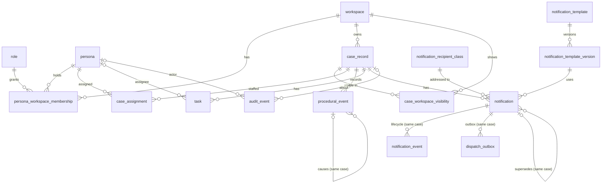

# E03 — Enterprise data model (Milestone M1)

**SYNTHETIC-DATA REFERENCE IMPLEMENTATION — not CDF production.** Owner: team DB. Schema `cdf_notifications_v13` in the
shared Supabase project CDF GC Review (ADR-012). Migrations `database/migrations/0001`–`0004`; seed in two parts:
`database/seed/0001_m1_synthetic.sql` (identity: workspaces, personas, memberships; needs migration 0001 only; audit row
`SEED_M1_LOADED`) and `database/seed/0002_m1_cases.sql` (cases and their history; needs 0001–0004; audit row
`SEED_M1_CASES_LOADED`).

Status: **IN_PROGRESS**. Delivered in two PRs. PR (a) `[V13-DB-001]` brings migration 0001 (identity, claims MAC, audit
ledger), seed part 1, the app-side claims MAC (`lib/db/security-context.ts`) and the key install at server start
(`instrumentation.ts` → `lib/db/claims-key-startup.ts`). PR (b) brings 0002–0004 and seed part 2; until it merges, the
sections on cases, tasks and notifications below describe that PR, not `develop`. Tested on a local PostgreSQL 16
cluster (`pnpm test:db`); not yet reviewed, not applied to the hosted schema (the Chief Architect applies merged
migrations).

## 1. Principles

- UUID primary keys everywhere; display numbers (`CDF-DEMO-2026-NNNN`) are labels, unique, never used for lookup.
- Every case-keyed row carries `case_id`. Child rows that must stay in the same case use **composite foreign keys**
  (`(parent_id, case_id)` → parent `(id, case_id)`), so the database itself refuses a row that points at one case's
  record under another case's id.
- RLS is enabled on every table. `cdf_v13_user` has `SELECT` only (where a policy allows it) and `EXECUTE` on named
  functions; it has no `INSERT`/`UPDATE`/`DELETE`/`TRUNCATE` anywhere. Writes go through `api_*` `SECURITY DEFINER`
  commands owned by `cdf_v13_owner` with `search_path = ''`.
- Every policy also requires `current_user = 'cdf_v13_user'` (SEC-REC-02), so a query that escaped the request
  context (running as `cdf_v13_app`) sees nothing.
- **Authenticated claims (ADR-014).** Each request transaction sets `request.v13.claims` =
  `{"v":1,"persona_id","workspace_id","correlation_id"}` and `request.v13.claims_mac` =
  base64url(HMAC-SHA256(K, claims ‖ `|` ‖ `pg_current_xact_id()`)), unpadded. K = HKDF-SHA256(`V13_SESSION_SECRET`,
  info `cdf-v13/request-claims/v1`), installed once with `api_install_claims_key`. `_verified_claims()` recomputes the
  MAC with core `sha256()` (pads precomputed at install; no pgcrypto) and accepts only exactly that shape with
  lower-case UUIDs. A forged claim, a claim rewritten after the MAC, a MAC replayed from another transaction, a missing
  key or a missing MAC all resolve to "no claims". Interop with Node `crypto.createHmac` checked on three vectors.
- Append-only tables (`audit_event`, `procedural_event`, `notification_event`, `notification_template_version`) refuse
  `UPDATE`/`DELETE` (and `TRUNCATE` where applicable) by trigger, for every role including the owner.
- JSONB only for small code/id attribute bags (`audit_event.metadata`, `procedural_event.attributes`), each limited to an
  object of at most 2 KB; never narrative or free text.

## 2. Entity-relationship diagram

## 3. Tables

| Migration | Table | Key columns | Notes |
| --------- | ----- | ----------- | ----- |
| 0000 | `schema_migrations` | `version` | V13 history; restrictive deny-all policy (0001) |
| 0001 | `workspace` | `id`, `code` unique | SECRETARIAT, INVESTIGATIONS, GOVERNANCE (seed) |
| 0001 | `role` | `id`, `code` unique | COMMITTEE_SECRETARY, INVESTIGATOR, GOVERNANCE_OFFICER (reference data in the migration) |
| 0001 | `persona` | `id`, `code`, `email` unique | `@example.test` enforced by a check; `is_active`; `email` not readable by `cdf_v13_user` (column grants), own address via `current_persona()` |
| 0001 | `persona_workspace_membership` | persona × workspace × role, `valid_from`/`valid_to` | active when `valid_from <= now() < valid_to` |
| 0001 | `claims_key` | `key_version` = 1 | ipad/opad keys + sha256 of K; restrictive deny-all, no grant; cleared only by `database/hosted/reset_claims_key.sql` |
| 0001 | `audit_event` | `id`, `seq` identity, `row_hash` unique | append-only, hash chain (`prev_hash` → `row_hash`), no reader grant |
| 0002 | `case_record` | `id`, `display_number` unique | stage, `is_restricted`, `records_state` ACTIVE/CLOSED (+`closed_at` consistency), `owning_workspace_id`, `source_system` = `V13_SYNTHETIC`, `source_ref`, `row_version` |
| 0002 | `case_workspace_visibility` | (`case_id`, `workspace_id`) | owning workspace inserted by trigger |
| 0002 | `case_assignment` | persona × case × capacity, window | capacities LEAD_INVESTIGATOR, INVESTIGATOR, SECRETARY, GOVERNANCE_REVIEWER |
| 0003 | `procedural_event` | `id`; unique (`id`, `case_id`) | append-only Layer A record; `occurred_at`/`recorded_at`; provenance RECORDED_IN_V13 / SEED_SYNTHETIC; `causation_id` same case |
| 0003 | `task` | `id`; unique (`id`, `case_id`) | status OPEN/IN_PROGRESS/BLOCKED/DONE/CANCELLED; `row_version` |
| 0004 | `notification_recipient_class` | `code` | reference data in the migration |
| 0004 | `notification_template` | `id`, `code` unique | `is_active` |
| 0004 | `notification_template_version` | (`template_id`, `version`, `language`) unique | immutable; `content_sha256` computed by trigger; `basis` = source reference |
| 0004 | `notification` | `id`, `idempotency_key` unique; unique (`id`, `case_id`) | lifecycle DRAFT…SUPERSEDED; `supersedes_id` same case |
| 0004 | `notification_event` | `id`; FK (`notification_id`, `case_id`) | append-only; `provenance` COMMAND (default) / SEED_SYNTHETIC |
| 0004 | `dispatch_outbox` | `id`; FK (`notification_id`, `case_id`); unique per channel | content-free; restrictive deny-all, no grant (ADR-010, used from M5) |

## 4. Functions

| Function | Kind | Granted to `cdf_v13_user` | Purpose |
| -------- | ---- | ------------------------- | ------- |
| `_verified_claims()`, `_claims_hmac(bytea)`, `_claim_uuid(text)` | internal definer | no | MAC check and v1 shape (§1) |
| `current_correlation_id()` | definer, stable | yes | correlation id of the verified claims; the only source of an audit row's correlation id (no override argument) |
| `current_persona()` | definer, stable | yes | own persona row incl. e-mail |
| `api_install_claims_key(bytea)` | definer command | yes | installs K while none exists; same key → `ALREADY_INSTALLED`; other key → `V1409`; audited `CLAIMS_KEY_INSTALLED` without key material |
| `current_persona_id()` | definer, stable | yes | claimed persona if it exists and is active, else NULL |
| `current_workspace_id()` | definer, stable | yes | claimed workspace if active and the persona has an active membership, else NULL |
| `current_role_codes()`, `has_role(text)` | definer, stable | yes | roles in the current workspace |
| `is_assigned_to_case(uuid)` | definer, stable | yes | active assignment on the case |
| `can_access_case(uuid)` | definer, stable | yes | **the single case-access rule** (§5) |
| `portfolio_page(...)`, `portfolio_count(...)` | invoker | yes | keyset page (limit 1..100) and count; RLS filters before filters, order, limit and count |
| `case_header(uuid)` | invoker | yes | one case by UUID; no row for unknown or unauthorised |
| `my_work_tasks(boolean)` | invoker | yes | the persona's tasks in accessible cases |
| `case_notifications(uuid)` | invoker | yes | notification history of one case |
| `api_update_task_status(uuid, text, int, uuid)` | definer command | yes | §6 |
| `api_create_notification_draft(uuid, uuid, text, text, uuid)` | definer command | yes | §6 |
| `verify_audit_chain()` | definer | **no** (owner/administrator) | recomputes the chain; counts and first broken `seq` only |
| `_append_audit`, `_audit_row_hash`, `_reject_mutation`, `_task_transition_allowed`, `_case_owning_visibility`, `_template_version_hash` | internal | no | — |
| `_is_colleague(uuid)` | internal definer | yes (used inside the `persona` policy) | persona is active and has an active membership in the current workspace (an inactive persona is never listed as a colleague) |

PUBLIC holds `EXECUTE` on no V13 function (default privileges from 0000; isolation check C11).

## 5. Access rule and the M1 visibility table

A persona sees a case when its claims resolve to an active persona **and** an active membership in the claimed
workspace, the case is listed in `case_workspace_visibility` for that workspace, and the case is not restricted or the
persona holds an active assignment on it. Closed cases stay readable; commands refuse to change them (V1423). Anything
else — unknown id, other workspace, restricted without assignment, missing or malformed claims, expired membership,
inactive persona — returns no row, exactly like an id that does not exist.

Seed visibility, measured on the local cluster (28 Oct 2026 ≈ 01:40 UTC, `select … from case_record` as `cdf_v13_user`):

| Persona @ workspace | Cases visible (`CDF-DEMO-2026-…`) | Count |
| ------------------- | --------------------------------- | ----- |
| Secretary Alpha @ SECRETARIAT | 0001, 0003, 0004, 0006, 0007, 0008, 0010 | 7 |
| Investigator Beta @ INVESTIGATIONS | 0001, 0002, 0003, 0005, 0006, **0009**, 0010 | 7 |
| Investigator Gamma @ INVESTIGATIONS | 0001, 0002, 0003, 0005, 0006, 0010 | 6 |
| Governance Officer Delta @ GOVERNANCE | 0001, 0002, 0003, 0004, 0007, 0008, 0010 | 7 |
| Governance Officer Delta @ SECRETARIAT | 0001, 0003, 0004, 0006, 0007, 0008, 0010 | 7 |
| Governance Officer Delta @ INVESTIGATIONS (not a member) | — | 0 |
| Secretary Epsilon @ SECRETARIAT (membership expired 2026-06-30) | — | 0 |
| Persona Zeta @ SECRETARIAT (persona inactive) | — | 0 |
| no claims / malformed claims | — | 0 |

0009 is restricted (only Investigator Beta is assigned); 0010 is closed.

## 6. Commands

Error codes (SQLSTATE class `V1`; the BFF maps them to a generic message with a correlation id): `V1401` no valid
context · `V1404` not found (unknown **and** unauthorised) · `V1409` stale `row_version` or duplicate idempotency key ·
`V1422` invalid input or transition · `V1423` case closed (raised only after access is proven) · `V1403` append-only
violation · `V1500` audit append outside READ COMMITTED.

| Command | Who | Checks | Writes (one transaction) |
| ------- | --- | ------ | ------------------------ |
| `api_update_task_status` | the task's assignee, or a persona with an active assignment on the case | context; task exists and `can_access_case`; case ACTIVE; expected `row_version`; allowed transition (DONE, CANCELLED terminal) | task (+1 version), `procedural_event` TASK_STATUS_CHANGED, `audit_event` TASK_STATUS_CHANGED |
| `api_create_notification_draft` | COMMITTEE_SECRETARY or INVESTIGATOR in the current workspace with case access | context; `can_access_case`; role; case ACTIVE; recipient class and active template version exist; key is 64 hex and unused (serialised by advisory lock in the V13 namespace) | `notification` DRAFT with the authorised `case_id`, `notification_event` DRAFT_CREATED, `audit_event` NOTIFICATION_DRAFT_CREATED |

## 6a. Definer discipline (TM-T10, SEC-DB-30)

Read functions are `SECURITY INVOKER`; any future view is `WITH (security_invoker = true)`; no table uses FORCE RLS.
`SECURITY DEFINER` is used only for: `api_*` commands (each calls `can_access_case` itself when case-keyed); the claims
and access-rule helpers and the `_case_owning_visibility` trigger; `current_persona()`; `_append_audit` and
`verify_audit_chain` (never granted to `cdf_v13_user`). A new definer function outside these groups needs ARCH and SEC.

## 6b. Seed notifications

All five seeded notifications are DRAFT with one DRAFT_CREATED event (provenance SEED_SYNTHETIC). No APPROVED or
DISPATCHED state exists in the seed: dispatch comes only from the outbox path (REQ-DISP-001, M5) and approval is a
decision right of the M5 approval command (REQ-DISP-009, REQ-GOV-014).

## 7. Audit ledger

`row_hash = sha256(seq | occurred_at (UTC text, µs) | actor | workspace | action | entity_type | entity_id | case_id |
correlation_id | metadata::jsonb text | prev_hash)`, genesis `prev_hash` = 64 zeros. Appends take
`pg_advisory_xact_lock(hashtext('cdf_notifications_v13'), 1)` and require READ COMMITTED, so each append sees the latest
committed row. Verified locally: the chain verifies under `TimeZone` Asia/Riyadh and America/New_York, and a row changed
with the guard trigger disabled is reported as the first broken `seq`.
`PRODUCTION_SUBSTITUTION_REQUIRED`: CDF SLS/SIEM export.

## 8. Production substitution

- Case records → the authoritative CDF case system behind `CaseSourceAdapter` (ADR-001).
- Personas, workspaces, memberships → CDF corporate IdP (OIDC) and directory groups (ADR-004).
- Database → dedicated RDS PostgreSQL in CDF Alibaba Cloud Riyadh (ADR-012).
- Outbox → approved CDF mail gateway and scheduler (ADR-010).
