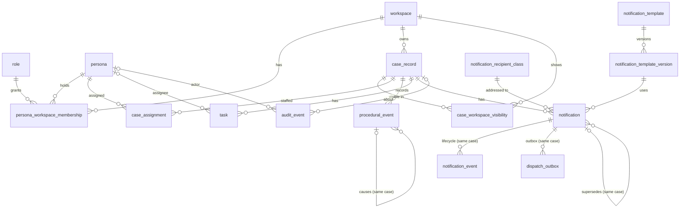

# E03 — Enterprise data model (Milestone M1)

**SYNTHETIC-DATA REFERENCE IMPLEMENTATION — not CDF production.** Owner: team DB. Schema `cdf_notifications_v13` in the
shared Supabase project CDF GC Review (ADR-012). Migrations `database/migrations/0001`–`0011`; seed in two parts:
`database/seed/0001_m1_synthetic.sql` (identity: workspaces, personas, memberships; needs migration 0001 only; audit row
`SEED_M1_LOADED`) and `database/seed/0002_m1_cases.sql` (cases and their history; needs 0001–0004; audit row
`SEED_M1_CASES_LOADED`).

Status: **COMPLETE** for M1 on `develop` (b5ee5f46): migrations 0001–0008 and both seed parts, merged through #12
(0001, identity seed, claims MAC, key install at start), #15 (0002–0004, cases seed), #17 (0005 workspace switch),
#21 (0006 Case Workspace reads), #28 (0007 claims-key state for health) and #31 (0008 My Work case columns), each on
SEC ACCEPT and green CI; 0009 (foreign-key index review, V13-DB-011) merged through #42 and 0010 (Notification
Operations Center reads, V13-DB-015) through #52. The rollback strategy of every migration is in §9 (REQ-DATA-023). Tested on a local PostgreSQL 16 cluster (`pnpm test:db`). Applied to the hosted schema only by the Chief Architect, with the plan procedure.

## 1. Principles

- UUID primary keys everywhere; display numbers (`CDF-DEMO-2026-NNNN`) are labels, unique, never used for lookup.
- Every case-keyed row carries `case_id`. Child rows that must stay in the same case use **composite foreign keys**
  (`(parent_id, case_id)` → parent `(id, case_id)`), so the database itself refuses a row that points at one case's
  record under another case's id.
- RLS is enabled on every table. `cdf_v13_user` has `SELECT` only (where a policy allows it) and `EXECUTE` on named
  functions; it has no `INSERT`/`UPDATE`/`DELETE`/`TRUNCATE` anywhere. Writes go through `api_*` `SECURITY DEFINER`
  commands owned by `cdf_v13_owner` with `search_path = ''`.
- Every policy also requires `current_user = 'cdf_v13_user'` (SEC-REC-02), so a query that escaped the request
  context (running as `cdf_v13_app`) sees nothing.
- **Authenticated claims (ADR-014).** Each request transaction sets `request.v13.claims` =
  `{"v":1,"persona_id","workspace_id","correlation_id"}` and `request.v13.claims_mac` =
  base64url(HMAC-SHA256(K, claims ‖ `|` ‖ `pg_current_xact_id()`)), unpadded. K = HKDF-SHA256(`V13_SESSION_SECRET`,
  info `cdf-v13/request-claims/v1`), installed once with `api_install_claims_key`. `_verified_claims()` recomputes the
  MAC with core `sha256()` (pads precomputed at install; no pgcrypto) and accepts only exactly that shape with
  lower-case UUIDs. A forged claim, a claim rewritten after the MAC, a MAC replayed from another transaction, a missing
  key or a missing MAC all resolve to "no claims". Interop with Node `crypto.createHmac` checked on three vectors.
- Append-only tables (`audit_event`, `procedural_event`, `notification_event`, `notification_template_version`) refuse
  `UPDATE`/`DELETE` (and `TRUNCATE` where applicable) by trigger, for every role including the owner.
- JSONB only for small code/id attribute bags (`audit_event.metadata`, `procedural_event.attributes`), each limited to an
  object of at most 2 KB; never narrative or free text.

## 2. Entity-relationship diagram

## 3. Tables

| Migration | Table | Key columns | Notes |
| --------- | ----- | ----------- | ----- |
| 0000 | `schema_migrations` | `version` | V13 history; restrictive deny-all policy (0001) |
| 0001 | `workspace` | `id`, `code` unique | SECRETARIAT, INVESTIGATIONS, GOVERNANCE (seed) |
| 0001 | `role` | `id`, `code` unique | COMMITTEE_SECRETARY, INVESTIGATOR, GOVERNANCE_OFFICER (reference data in the migration) |
| 0001 | `persona` | `id`, `code`, `email` unique | `@example.test` enforced by a check; `is_active`; `email` not readable by `cdf_v13_user` (column grants), own address via `current_persona()` |
| 0001 | `persona_workspace_membership` | persona × workspace × role, `valid_from`/`valid_to` | active when `valid_from <= now() < valid_to` |
| 0001 | `claims_key` | `key_version` = 1 | ipad/opad keys + sha256 of K; restrictive deny-all, no grant; cleared only by `database/hosted/reset_claims_key.sql` |
| 0001 | `audit_event` | `id`, `seq` identity, `row_hash` unique | append-only, hash chain (`prev_hash` → `row_hash`), no reader grant |
| 0002 | `case_record` | `id`, `display_number` unique | stage, `is_restricted`, `records_state` ACTIVE/CLOSED (+`closed_at` consistency), `owning_workspace_id`, `source_system` = `V13_SYNTHETIC`, `source_ref` NOT NULL (pattern-checked; seed `seed:m1:NNNN`), `row_version`, `updated_at` |
| 0002 | `case_workspace_visibility` | (`case_id`, `workspace_id`) | owning workspace inserted by trigger |
| 0002 | `case_assignment` | persona × case × capacity, window | capacities LEAD_INVESTIGATOR, INVESTIGATOR, SECRETARY, GOVERNANCE_REVIEWER |
| 0003 | `procedural_event` | `id`; unique (`id`, `case_id`) | append-only Layer A record; `occurred_at`/`recorded_at`; provenance RECORDED_IN_V13 / SEED_SYNTHETIC; `causation_id` same case |
| 0003 | `task` | `id`; unique (`id`, `case_id`) | status OPEN/IN_PROGRESS/BLOCKED/DONE/CANCELLED; `row_version` |
| 0004 | `notification_recipient_class` | `code` | reference data in the migration |
| 0004 | `notification_template` | `id`, `code` unique | `is_active` |
| 0004 | `notification_template_version` | (`template_id`, `version`, `language`) unique | immutable; `content_sha256` computed by trigger; `basis` = source reference |
| 0004 | `notification` | `id`; unique (`created_by_persona_id`, `idempotency_key`) (keys scoped to their author); unique (`id`, `case_id`) | lifecycle DRAFT…SUPERSEDED; `supersedes_id` same case |
| 0004 | `notification_event` | `id`; FK (`notification_id`, `case_id`) | append-only; `provenance` COMMAND (default) / SEED_SYNTHETIC |
| 0004 | `dispatch_outbox` | `id`; FK (`notification_id`, `case_id`); unique per channel | content-free; restrictive deny-all, no grant (ADR-010, used from M5) |

## 4. Functions

| Function | Kind | Granted to `cdf_v13_user` | Purpose |
| -------- | ---- | ------------------------- | ------- |
| `_verified_claims()`, `_claims_hmac(bytea)`, `_claim_uuid(text)` | internal definer | no | MAC check and v1 shape (§1) |
| `current_correlation_id()` | definer, stable | yes | correlation id of the verified claims; the only source of an audit row's correlation id (no override argument) |
| `current_persona()` | definer, stable | yes | own persona row incl. e-mail |
| `api_install_claims_key(bytea)` | definer command | yes | installs K while none exists; same key → `ALREADY_INSTALLED`; other key → `V1409`; audited `CLAIMS_KEY_INSTALLED` without key material |
| `claims_key_state(text)` (migration 0007, V13-DB-009) | definer, stable | yes (not `cdf_v13_app`) | health only: `NOT_INSTALLED`, `INSTALLED_MATCH` or `INSTALLED_MISMATCH` for a probe = base64url HMAC(K, `cdf-v13/claims-key-probe/v1\|<xid>`) of this transaction; a code only, never key material; not audited |
| `current_persona_id()` | definer, stable | yes | claimed persona if it exists and is active, else NULL |
| `current_workspace_id()` | definer, stable | yes | claimed workspace if active and the persona has an active membership, else NULL |
| `current_role_codes()`, `has_role(text)` | definer, stable | yes | roles in the current workspace |
| `is_assigned_to_case(uuid)` | definer, stable | yes | active assignment on the case |
| `can_access_case(uuid)` | definer, stable | yes | **the single case-access rule** (§5) |
| `portfolio_page(...)`, `portfolio_count(...)` (migration 0003) | invoker | yes | keyset page (limit 1..100) and count with one filter set (stage, records state, search, assigned-to-me = active case assignment); RLS filters before filters, order, limit, count and row summaries; rows carry `updated_at`, `source_system`, `source_ref`, the case's last recorded event (`last_event_id`, `last_event_at`) and the caller's own open-task count (`my_open_task_count`) (FE contract ruling and FE-003, 28 Oct) |
| `case_header(uuid)` | invoker | yes | one case by UUID, same columns as a portfolio row plus `my_capacity` (the caller's active capacity on the case, or NULL; migration 0006); no row for unknown or unauthorised |
| `case_events(uuid)` (migration 0006) | invoker | yes | the case's procedural events, newest first (`occurred_at`, `recorded_at`, `id`); the actor only as `actor_capacity` (the recorder's capacity on the case at `occurred_at`, or NULL) |
| `case_tasks(uuid)` (migration 0006) | invoker | yes | the case's tasks; the assignee only as `assignee_capacity` (now) and `is_mine`; `status_event_id` = latest procedural event about the task |
| `_capacity_rank(text)` (migration 0006) | immutable, no table access | yes | display order when a persona holds several capacities: LEAD_INVESTIGATOR, INVESTIGATOR, SECRETARY, GOVERNANCE_REVIEWER |
| `my_work_tasks(boolean)` | invoker | yes | the persona's own tasks in cases accessible in the current workspace (open only unless `true`); order due date nulls last, display number, task code. Migration 0008 appends `case_title_ar`, `case_title_en`, `case_records_state` (UI hint only; V1423 stays the authority) and `status_event_id` (as `case_tasks`) |
| `case_notifications(uuid)` | invoker | yes | notification history of one case |
| `notifications_page(...)`, `notifications_count(...)` (migration 0010, V13-DB-015) | invoker | yes | Notification Operations Center (UX S4, FE-006): notifications across every case the caller may see, with exactly the access of `case_notifications` (RLS before filters, order, limit, count and summaries). Rows: case id, number and titles, template code, names, version and language, recipient class, lifecycle status, `created_at`, `created_at_cursor`, `last_event_at`, `row_version`; no person. Filters (identical for page and count): lifecycle status, template code, case display number (after authorisation, never a key), created range `[from, before)`. Keyset on (`created_at` desc, id desc): pass `created_at_cursor` (text, `YYYY-MM-DDTHH:MI:SS.ffffffZ`) and the id of the last row, or neither; half a cursor or another text form matches nothing. Limit 1..100 |
| `case_events_page(...)`, `case_tasks_page(...)`, `case_notifications_page(...)` (migration 0011, V13-DB-019, OI-026) | invoker | yes | the three per-case reads one bounded page at a time: same rows, order and columns as `case_events` / `case_tasks` / `case_notifications`, plus `page_cursor`. Arguments `(p_case_id, p_after_cursor, p_after_id, p_limit)`: pass `page_cursor` and the id of the last row, or neither. The cursor row must be visible in the same case and carry exactly that `page_cursor`; the keyset then uses its stored values. A half, malformed, stale or foreign cursor returns no rows, the same answer as an unknown or unauthorised case. Limit 1..100 (default 25); any other value, NULL included, is refused with 22023, never clamped. Index `task_case_page_idx` serves the task order; the events and notifications orders use the 0003 and 0004 case indexes. The unpaged reads are unchanged |
| `_page_limit(integer)` (migration 0011) | immutable, no table access | yes | returns the page limit if it is 1..100, else raises 22023 |
| `api_update_task_status(uuid, text, int)` | definer command | yes | §6 |
| `api_create_notification_draft(uuid, uuid, text, text)` | definer command | yes | §6 |
| `api_switch_workspace(uuid)` (migration 0005) | definer command | yes | §6; returns the target workspace id, code and the persona's role codes there |
| `verify_audit_chain()` | definer | **no** (owner/administrator) | recomputes the chain; counts and first broken `seq` only |
| `_append_audit`, `_audit_row_hash`, `_reject_mutation`, `_task_transition_allowed`, `_case_owning_visibility`, `_template_version_hash` | internal | no | — |
| `_is_colleague(uuid)` | internal definer | yes (used inside the `persona` policy) | persona is active and has an active membership in the current workspace (an inactive persona is never listed as a colleague) |

PUBLIC holds `EXECUTE` on no V13 function (default privileges from 0000; isolation check C11).

## 5. Access rule and the M1 visibility table

A persona sees a case when its claims resolve to an active persona **and** an active membership in the claimed
workspace, the case is listed in `case_workspace_visibility` for that workspace, and the case is not restricted or the
persona holds an active assignment on it. Closed cases stay readable; commands refuse to change them (V1423). Anything
else — unknown id, other workspace, restricted without assignment, missing or malformed claims, expired membership,
inactive persona — returns no row, exactly like an id that does not exist.

Seed visibility, measured on the local cluster (28 Oct 2026 ≈ 01:40 UTC, `select … from case_record` as `cdf_v13_user`):

| Persona @ workspace | Cases visible (`CDF-DEMO-2026-…`) | Count |
| ------------------- | --------------------------------- | ----- |
| Secretary Alpha @ SECRETARIAT | 0001, 0003, 0004, 0006, 0007, 0008, 0010 | 7 |
| Investigator Beta @ INVESTIGATIONS | 0001, 0002, 0003, 0005, 0006, **0009**, 0010 | 7 |
| Investigator Gamma @ INVESTIGATIONS | 0001, 0002, 0003, 0005, 0006, 0010 | 6 |
| Governance Officer Delta @ GOVERNANCE | 0001, 0002, 0003, 0004, 0007, 0008, 0010 | 7 |
| Governance Officer Delta @ SECRETARIAT | 0001, 0003, 0004, 0006, 0007, 0008, 0010 | 7 |
| Governance Officer Delta @ INVESTIGATIONS (not a member) | — | 0 |
| Secretary Epsilon @ SECRETARIAT (membership expired 2026-06-30) | — | 0 |
| Persona Zeta @ SECRETARIAT (persona inactive) | — | 0 |
| no claims / malformed claims | — | 0 |

0009 is restricted (only Investigator Beta is assigned); 0010 is closed.

## 6. Commands

Error codes (SQLSTATE class `V1`; the BFF maps them to a generic message with a correlation id): `V1401` no valid
context · `V1404` not found (unknown **and** unauthorised) · `V1409` stale `row_version` or duplicate idempotency key ·
`V1422` invalid input or transition · `V1423` case closed (raised only after access is proven) · `V1403` append-only
violation · `V1500` audit append outside READ COMMITTED.

| Command | Who | Checks | Writes (one transaction) |
| ------- | --- | ------ | ------------------------ |
| `api_update_task_status` | the task's assignee, or a persona with an active assignment on the case | context; task exists and `can_access_case`, checked before the row is locked (`FOR UPDATE` only after access is proven, so a caller without access never waits on or locks a task); case ACTIVE; expected `row_version`; allowed transition (DONE, CANCELLED terminal) | task (+1 version), `procedural_event` TASK_STATUS_CHANGED, `audit_event` TASK_STATUS_CHANGED |
| `api_create_notification_draft` | COMMITTEE_SECRETARY or INVESTIGATOR in the current workspace with case access | context; `can_access_case`; role; case ACTIVE; recipient class and active template version exist; key is 64 hex and not used before by the same persona (serialised by an advisory lock on author and key in the V13 namespace; another persona's key gives no signal) | `notification` DRAFT with the authorised `case_id`, `notification_event` DRAFT_CREATED, `audit_event` NOTIFICATION_DRAFT_CREATED |
| `api_switch_workspace` | any verified persona | context (V1401 otherwise); target workspace exists and is active, and the persona holds a membership there that is valid now (`valid_from <= now()`, `valid_to` null or later); NULL, unknown, inactive and non-member targets all give the same V1404. Switching to the current workspace is allowed. The BFF issues the new cookie only after the command commits | `audit_event` WORKSPACE_SWITCHED (entity `workspace` = target; metadata ids only: `from_workspace_id` = the claimed workspace when the persona can use it, else null, and `to_workspace_id`); nothing else |

## 6a. Definer discipline (TM-T10, SEC-DB-30)

Read functions are `SECURITY INVOKER`; any future view is `WITH (security_invoker = true)`; no table uses FORCE RLS.
`SECURITY DEFINER` is used only for: `api_*` commands (each calls `can_access_case` itself when case-keyed); the claims
and access-rule helpers and the `_case_owning_visibility` trigger; `current_persona()`; `_append_audit` and
`verify_audit_chain` (never granted to `cdf_v13_user`). A new definer function outside these groups needs ARCH and SEC.

## 6b. Seed notifications

All five seeded notifications are DRAFT with one DRAFT_CREATED event (provenance SEED_SYNTHETIC). No APPROVED or
DISPATCHED state exists in the seed: dispatch comes only from the outbox path (REQ-DISP-001, M5) and approval is a
decision right of the M5 approval command (REQ-DISP-009, REQ-GOV-014).

## 7. Audit ledger

`row_hash = sha256(seq | occurred_at (UTC text, µs) | actor | workspace | action | entity_type | entity_id | case_id |
correlation_id | metadata::jsonb text | prev_hash)`, genesis `prev_hash` = 64 zeros. Appends take
`pg_advisory_xact_lock(hashtext('cdf_notifications_v13'), 1)` and require READ COMMITTED, so each append sees the latest
committed row. Verified locally: the chain verifies under `TimeZone` Asia/Riyadh and America/New_York, and a row changed
with the guard trigger disabled is reported as the first broken `seq`.
`PRODUCTION_SUBSTITUTION_REQUIRED`: CDF SLS/SIEM export.

## 8. Production substitution

- Case records → the authoritative CDF case system behind `CaseSourceAdapter` (ADR-001).
- Personas, workspaces, memberships → CDF corporate IdP (OIDC) and directory groups (ADR-004).
- Database → dedicated RDS PostgreSQL in CDF Alibaba Cloud Riyadh (ADR-012).
- Outbox → approved CDF mail gateway and scheduler (ADR-010).

## Foreign-key indexes (migration 0009, V13-DB-011, OI-032)

A foreign key gets an index when its parent can be deleted or re-keyed, or when a read finds child rows by it. No V13
parent key changes and no application path deletes a parent (append-only tables refuse UPDATE and DELETE), so 13 of the
advisor's 14 unindexed-FK findings are **accepted**, each with its reason in `0009_fk_index_review.sql`. One is
**indexed**: `notification_event_notification_idx` becomes `(notification_id, case_id, occurred_at)`, leading with the
FK `(notification_id, case_id)` while keeping the timeline order. `tests/integration/fk-index-coverage.spec.ts` fails
on any new foreign key until it is indexed or added to the accepted list. Revisit when a reader by that key arrives
(recipient inbox: `notification_recipient_persona_id`; supersede command: `notification_supersedes_fk`).

## 9. Migration rollback register (REQ-DATA-023, V13-DB-018)

One entry per migration file. **Creates**, **Replaces** (dropped and created again in the same file), **Drops** and
**Alters** (a constraint or column added to an earlier table) list the objects as `kind name`, all in schema
`cdf_notifications_v13` except roles. `tests/unit/rollback-register.spec.ts` (and `node scripts/db/rollback-register.mjs`)
fails when a migration has no entry, when an entry has no migration, or when a list differs from the migration's own
CREATE, DROP and ALTER TABLE … ADD statements. A CREATE or DROP form the checker does not know fails it too.

Strategies, the same for every migration:

- **Local** (developer cluster, CI): `pnpm db:reset` drops the local database `v13_local` and the three V13 roles and
  rebuilds them from Git (migrations, then seeds). To revert a migration locally, check out the tree without it (or with the fix) and reset.
  Nothing is kept, and only synthetic data is lost.
- **Hosted** (shared CDF GC Review project, ADR-012): applied migrations are never edited and never reversed in place.
  A defect is corrected by a **forward-fix migration**: the next free number, through the plan §6 procedure (review
  ACCEPT, dry run, apply, fingerprint, isolation and post-apply checks), applied by the Chief Architect. Before the
  fix lands, access can be cut first (plan §7: remove `V13_DATABASE_URL` or set `cdf_v13_app` NOLOGIN). To restore an
  earlier definition, the forward fix recreates it from Git history. Grants, RLS enabling and policies are not
  register items, so a forward fix that drops and recreates a table or function also restores its grants, RLS and
  policies in the same migration (db:lint and `post_apply_checks.sql` check them). The only way back further is
  `database/hosted/rollback_v13.sql`, which removes the whole V13 schema and its three roles, and **only on the owner's
  explicit word** (plan §7). There are no per-migration reverse or DROP scripts. After a full removal, the schema is
  rebuilt by applying 0000 onwards again, then the seeds.

What is lost: the data held in the objects a revert removes. In V13 that is reference data a migration inserts itself (roles in 0001,
recipient classes in 0004), which only re-applying that migration restores; synthetic seed data, which the seed bundles
reload; plus rows written at run time by commands (audit events, task status changes, notification drafts, workspace
switches), which nothing can reload. Function, policy and index changes hold no data.

### 0000_bootstrap.sql

- **Creates:** `role cdf_v13_owner`, `role cdf_v13_user`, `role cdf_v13_app`, `schema cdf_notifications_v13`,
  `table schema_migrations`
- **Replaces:** none
- **Drops:** none
- **Alters:** none
- **Data lost on revert:** everything V13 holds. Every later migration depends on the schema and roles, so reverting
  0000 means removing all of V13, including the migration history.
- **Local:** `pnpm db:reset`.
- **Hosted:** a forward-fix migration for a defect in a role setting or grant. Removal of 0000 itself only through
  `rollback_v13.sql` on the owner's explicit word; nothing narrower exists.

### 0001_identity_access_audit.sql

- **Creates:** `table workspace`, `table role`, `table persona`, `table persona_workspace_membership`,
  `index persona_workspace_membership_persona_idx`, `table claims_key`, `table audit_event`,
  `index audit_event_case_idx`, `policy schema_migrations_deny_all`, `policy claims_key_deny_all`,
  `policy workspace_select_member`, `policy role_select_signed_in`, `policy persona_select_self_or_colleague`,
  `policy membership_select_own`, `policy audit_event_deny_all`, `trigger audit_event_no_update_delete`,
  `trigger audit_event_no_truncate`, `function _claims_hmac`, `function _verified_claims`, `function _claim_uuid`,
  `function current_correlation_id`, `function api_install_claims_key`, `function current_persona_id`,
  `function current_workspace_id`, `function current_role_codes`, `function has_role`, `function _is_colleague`,
  `function current_persona`, `function _audit_row_hash`, `function _append_audit`, `function _reject_mutation`,
  `function verify_audit_chain`
- **Replaces:** none
- **Drops:** none
- **Alters:** none
- **Data lost on revert:** the role catalogue, which 0001 inserts itself and only re-applying 0001 restores; the
  identity seed (workspaces, personas, memberships; reloaded by seed 0001); the installed claims key (the app installs a new one at server start), and the **audit ledger**, whose run-time events
  cannot be reloaded. 0002–0010 depend on these tables and functions.
- **Local:** `pnpm db:reset`.
- **Hosted:** a forward-fix migration (for example a corrected function or policy). The ledger is append-only and is
  never reverted in part. Removing 0001 means removing V13 (`rollback_v13.sql`, owner's explicit word).

### 0002_case_registry.sql

- **Creates:** `table case_record`, `table case_workspace_visibility`, `index case_workspace_visibility_ws_idx`,
  `table case_assignment`, `index case_assignment_persona_idx`, `function _case_owning_visibility`,
  `trigger case_record_owning_visibility`, `function is_assigned_to_case`, `function can_access_case`,
  `policy case_record_select`, `policy case_workspace_visibility_select`, `policy case_assignment_select`,
  `function case_header`
- **Replaces:** none
- **Drops:** none
- **Alters:** `constraint audit_event_case_fk on audit_event`
- **Data lost on revert:** the synthetic cases, their visibility and assignments (reloaded by seed 0002). Dropping
  `case_record` also needs the `audit_event_case_fk` constraint removed, and 0003, 0004, 0006, 0008 and 0010 depend on
  these tables or on `can_access_case`.
- **Local:** `pnpm db:reset`.
- **Hosted:** a forward-fix migration; an access-rule defect is fixed by recreating `can_access_case` or a policy. Full
  removal only through `rollback_v13.sql` on the owner's explicit word.

### 0003_procedural_core.sql

- **Creates:** `table procedural_event`, `index procedural_event_case_idx`, `trigger procedural_event_no_update_delete`,
  `trigger procedural_event_no_truncate`, `table task`, `index task_case_idx`, `index task_assignee_idx`,
  `policy procedural_event_select`, `policy task_select`, `function _task_transition_allowed`,
  `function api_update_task_status`, `function my_work_tasks`, `function portfolio_page`, `function portfolio_count`
- **Replaces:** none
- **Drops:** none
- **Alters:** none
- **Data lost on revert:** seeded procedural events and tasks (reloaded by seed 0002), and task status changes made at
  run time. 0006 and 0008 read these tables.
- **Local:** `pnpm db:reset`.
- **Hosted:** a forward-fix migration (a corrected command or read, as 0008 did for `my_work_tasks`). Full removal only
  through `rollback_v13.sql` on the owner's explicit word.

### 0004_notification_core.sql

- **Creates:** `table notification_recipient_class`, `table notification_template`,
  `table notification_template_version`, `function _template_version_hash`,
  `trigger notification_template_version_hash`, `trigger notification_template_version_immutable`,
  `table notification`, `index notification_case_idx`, `table notification_event`,
  `index notification_event_notification_idx`, `trigger notification_event_no_update_delete`,
  `trigger notification_event_no_truncate`, `table dispatch_outbox`, `policy notification_recipient_class_select`,
  `policy notification_template_select`, `policy notification_template_version_select`, `policy notification_select`,
  `policy notification_event_select`, `policy dispatch_outbox_deny_all`, `function api_create_notification_draft`,
  `function case_notifications`
- **Replaces:** none
- **Drops:** none
- **Alters:** none
- **Data lost on revert:** the recipient classes, which 0004 inserts itself and only re-applying 0004 restores; the
  seeded templates, template versions and draft notifications (reloaded by seed 0002); notification drafts and events created at run time. The outbox holds no content. 0009 and 0010
  depend on these tables.
- **Local:** `pnpm db:reset`.
- **Hosted:** a forward-fix migration. Template versions are immutable, so a wrong version is superseded by a new one,
  never edited. Full removal only through `rollback_v13.sql` on the owner's explicit word.

### 0005_workspace_switch.sql

- **Creates:** `function api_switch_workspace`
- **Replaces:** none
- **Drops:** none
- **Alters:** none
- **Data lost on revert:** none. The function holds no data; the WORKSPACE_SWITCHED audit events it wrote stay in the
  ledger.
- **Local:** `pnpm db:reset`.
- **Hosted:** a forward-fix migration that drops or recreates `api_switch_workspace`, with the FE switcher changed in
  the same release.

### 0006_case_workspace_reads.sql

- **Creates:** `function _capacity_rank`, `function case_events`, `function case_tasks`
- **Replaces:** `function case_header`
- **Drops:** none
- **Alters:** none
- **Data lost on revert:** none (functions only). Reverting `case_header` means recreating the 0002 definition, which
  has no `my_capacity` column, so the FE case header must change with it.
- **Local:** `pnpm db:reset`.
- **Hosted:** a forward-fix migration that recreates the 0002 `case_header` from Git history, or a corrected one, and
  drops or recreates the three new reads.

### 0007_claims_key_state.sql

- **Creates:** `function claims_key_state`
- **Replaces:** none
- **Drops:** none
- **Alters:** none
- **Data lost on revert:** none. `/api/health` would report the probe as failing until the app changes with it.
- **Local:** `pnpm db:reset`.
- **Hosted:** a forward-fix migration that drops or recreates `claims_key_state`.

### 0008_my_work_case_columns.sql

- **Creates:** none
- **Replaces:** `function my_work_tasks`
- **Drops:** none
- **Alters:** none
- **Data lost on revert:** none. The 0003 definition lacks the four case columns My Work shows, so the FE changes with
  it.
- **Local:** `pnpm db:reset`.
- **Hosted:** a forward-fix migration that drops and recreates `my_work_tasks` with the 0003 definition from Git
  history (the result type changes, so `create or replace` is not enough).

### 0009_fk_index_review.sql

- **Creates:** none
- **Replaces:** `index notification_event_notification_idx`
- **Drops:** none
- **Alters:** none
- **Data lost on revert:** none (an index). `tests/integration/fk-index-coverage.spec.ts` would then fail on the
  unindexed `notification_event_notification_fk`.
- **Local:** `pnpm db:reset`.
- **Hosted:** a forward-fix migration that drops the index and creates the 0004 one.

### 0010_notification_operations_reads.sql

- **Creates:** `index notification_created_idx`, `function notifications_page`, `function notifications_count`
- **Replaces:** none
- **Drops:** none
- **Alters:** none
- **Data lost on revert:** none (an index and two reads). The Notification Operations Center changes with it.
- **Local:** `pnpm db:reset`.
- **Hosted:** a forward-fix migration that drops or recreates the two functions and the index.

### 0011_case_paged_reads.sql

- **Creates:** `function _page_limit`, `index task_case_page_idx`, `function case_events_page`,
  `function case_tasks_page`, `function case_notifications_page`
- **Replaces:** none
- **Drops:** none
- **Alters:** none
- **Data lost on revert:** none (four functions and an index). The unpaged reads stay, so a revert only takes paging
  away from any caller that switched to the paged reads.
- **Local:** `pnpm db:reset`.
- **Hosted:** a forward-fix migration that drops or recreates the three paged reads, `_page_limit` and the index, with
  their grants.
